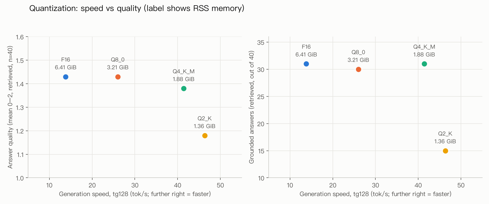
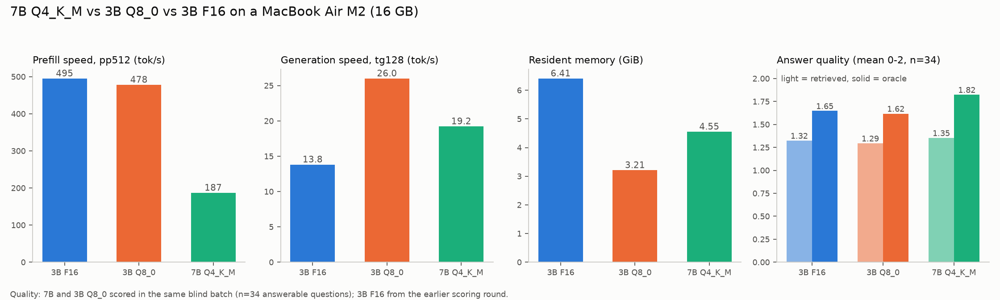
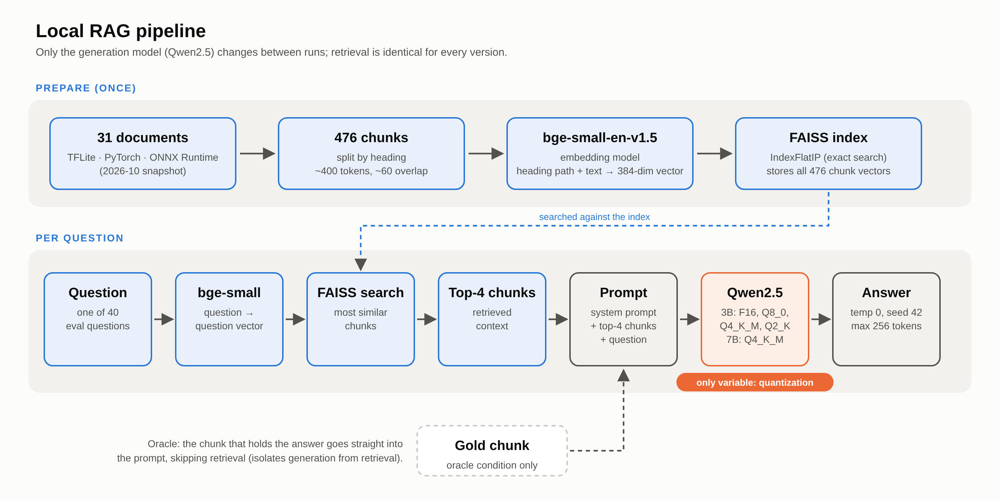

# Local RAG Quantization Study

How much does quantization cost a local RAG system, and where is the practical knee?
One fixed RAG pipeline, one model family (Qwen2.5-Instruct), four quantization levels of the 3B model
(F16, Q8_0, Q4_K_M, Q2_K), plus a 7B Q4_K_M run at a similar memory budget.
Everything runs on a MacBook Air (Apple M2, 16 GB) with llama.cpp (Metal).

## Key findings

1. **Q4_K_M is the sweet spot.** Compared with the full-precision (F16) model, it uses about 70% less memory
   and generates about 3x faster, with almost no loss in answer quality (perplexity +2.5%).
   Going one step further to Q2_K barely adds speed (1.12x) but quality drops sharply
   (perplexity +47%, grounded answers 31 → 15 out of 40).
2. **Retrieval matters more than quantization.** Giving the model the right passage directly (oracle) improves answers
   more than any quantization level changes them, until Q2_K (F16: 1.65 with the right passage vs 1.32 with real retrieval).
3. **A bigger model is not a free upgrade.** 7B Q4_K_M (4.55 GiB) answers about as well as 3B Q8_0 (3.21 GiB) with real retrieval
   (1.35 vs 1.29, within noise), but generates 26% slower and reads the prompt 61% slower.
   Prompt reading (prefill) dominates RAG latency, so the practical slowdown is larger than the generation number suggests.



*Figure 1. The four 3B quantization levels. Further right = faster generation; higher = better answers (left) or more grounded answers (right). Labels show memory use. F16, Q8_0 and Q4_K_M sit close together; Q2_K drops.*



*Figure 2. 7B Q4_K_M against 3B Q8_0 (closest cheaper option) and 3B F16 (full-precision reference). In the quality panel, light bars use real retrieval and solid bars give the model the correct passage directly.*

## Setup



*Figure 3. The pipeline. Retrieval (blue) is identical for every run; only the generation model (orange) changes.*

| Item | Choice |
|---|---|
| Hardware | MacBook Air, Apple M2, 16 GB unified memory, Metal + BLAS, 4 threads |
| Runtime | llama.cpp build 11591 (`bfe65e1df`) |
| Models | Qwen2.5-3B-Instruct: F16, Q8_0, Q4_K_M, Q2_K; Qwen2.5-7B-Instruct: Q4_K_M |
| Corpus | 31 official quantization docs (TFLite 11, PyTorch/torchao 14, ONNX Runtime 6), snapshot 2026-10 |
| Chunks | 476 chunks, split by heading, ~400 tokens, ~60 overlap |
| Retrieval | `BAAI/bge-small-en-v1.5`, FAISS `IndexFlatIP`, top-4 chunks per question. Retrieval is run once and the results are reused for every model version, so only quantization differs between runs |
| Generation | `llama-server -c 4096 -ngl 99`, temperature 0, seed 42, max 256 tokens, fixed system prompt |
| Eval set | 40 questions: 16 fact, 12 compare, 6 number, 6 unanswerable (tests hallucination) |
| Two conditions | **retrieved** (40 questions, top-4 chunks) and **oracle** (34 answerable questions, gold chunk given directly, isolates generation from retrieval) |

Only the quantization level changes between runs. The embedder, index, retrieved contexts, prompt and sampling are identical.

## Results

### 3B: speed, memory, quality

| Version | File (GiB) | RSS (GiB) | pp512 (tok/s) | tg128 (tok/s) | Perplexity (wikitext-2) | Quality, retrieved (0-2, n=34) | Quality, oracle (0-2, n=34) | Grounded, retrieved (/40) | Grounded, oracle (/34) |
|---|---|---|---|---|---|---|---|---|---|
| F16 | 6.33 | 6.41 | 495.08 | 13.82 | 9.095 ± 0.064 | 1.32 | 1.65 | 31 | 33 |
| Q8_0 | 3.36 | 3.21 | 478.11 | 26.00 | 9.095 ± 0.064 | 1.32 | 1.62 | 30 | 34 |
| Q4_K_M | 1.95 | 1.88 | 429.60 | 41.42 | 9.324 ± 0.065 | 1.26 | 1.59 | 31 | 30 |
| Q2_K | 1.28 | 1.36 | 431.98 | 46.33 | 13.708 ± 0.102 | 1.15 | 1.44 | 15 | 22 |

Speed is `llama-bench`: prefill (pp512, 512 prompt tokens) and generation (tg128, 128 new tokens), each averaged over 3 runs. RSS is the maximum resident set size from `/usr/bin/time -l` during the benchmark
(weights plus a small KV cache, not the `-c 4096` server). Perplexity is `llama-perplexity` on the wikitext-2 test set (`-c 512`),
± is the standard error. Quality is the mean correctness (0 wrong, 1 partial, 2 correct) on the 34 answerable questions.
The 6 unanswerable questions are scored separately (a correct refusal scores 2): F16, Q8_0 and Q4_K_M refused all 6; Q2_K refused 4 and answered 2 with unrelated content.
"Grounded" counts answers whose claims all appear in the context the model was given (scored separately from correctness).
A correct refusal ("I cannot find this in the provided documents") counts as grounded, so the maximum is 40 for retrieved (including the 6 unanswerable questions) and 34 for oracle.

Step-by-step return on each downgrade:

| Step | Generation speed | Memory | Perplexity | Grounded (retrieved) |
|---|---|---|---|---|
| F16 → Q8_0 | 1.88x | -50% | ~0% | 31 → 30 |
| Q8_0 → Q4_K_M | 1.59x | -41% | +2.5% | 30 → 31 |
| Q4_K_M → Q2_K | 1.12x | -28% | +47% | 31 → 15 |

F16, Q8_0 and Q4_K_M show no clear difference in answer quality: differences of about 0.06 correspond to 1-2 questions out of 34.

### What breaks at Q2_K

Of Q2_K's 74 answers (40 retrieved + 34 oracle), 47 were not fully correct or not grounded.
For about 21 of them, the other three versions handled the same question fine, so they are Q2_K-specific. The main patterns:
invented expansions of abbreviations (e.g. "CER" expanded to a wrong full name), false refusals when the answer was in the context,
and answers about 1.7x longer than the other versions. On the 6 unanswerable questions, Q2_K answered 2 with unrelated content and invented
abbreviation expansions in 3 of its refusals; the other three versions refused all 6 cleanly.

### Retrieval vs quantization

With top-4 retrieval, the retrieved context contains the answer for 22 of 34 answerable questions (65%), part of it for 7, and none of it for 5 (judged by reading each case).
When it is absent, all four versions score 0.20 on average. The F16 gap between oracle and retrieved (1.65 vs 1.32) is larger than the gap between F16 and Q4_K_M in either condition.

### 7B Q4_K_M vs 3B Q8_0 (similar memory budget)

7B Q4_K_M uses 4.55 GiB, between 3B Q8_0 (3.21 GiB) and 3B F16 (6.41 GiB), so both are shown:
Q8_0 as the closest cheaper option, F16 as the full-precision reference.

| | 3B F16 | 3B Q8_0 | 7B Q4_K_M |
|---|---|---|---|
| RSS (GiB) | 6.41 | 3.21 | 4.55 |
| pp512 (tok/s) | 495.08 | 478.11 | 186.97 |
| tg128 (tok/s) | 13.82 | 26.00 | 19.22 |
| Quality, retrieved (n=34) | 1.32 | 1.29 | 1.35 |
| Quality, oracle (n=34) | 1.65 | 1.62 | 1.82 |
| Grounded, retrieved (/40) | 31 | 31 | 33 |
| Grounded, oracle (/34) | 33 | 33 | 29 |

7B and 3B Q8_0 were scored together in one blind batch (versions hidden), which makes their comparison the fairest one here.
3B F16 was scored in the earlier round. Q8_0 values in this table come from the new batch, so they can differ by 1 from the table above.

- With real retrieval there is no clear difference (1.35 vs 1.29, within scoring noise). With the correct passage given directly (oracle), 7B is better (mostly on number questions), but it adds content that is not in the context more often (29/34 grounded vs 33/34).
- 7B prefill is 0.39x of 3B Q8_0 in the benchmark (187 vs 478 tok/s). A RAG prompt is about 1,100 tokens, so prefill takes a large share of each query:
  in the server runs, time to first token and total time per question roughly doubled (table below).
- Memory is similar but not equal (4.55 vs 3.21 GiB).
- Compared with 3B F16 (the full-precision reference), 7B Q4_K_M uses 29% less memory and generates 1.39x faster, with quality at least as good.
  (F16 was scored in the earlier round, so this is a rougher comparison.)

Latency per question through `llama-server` (retrieved condition, 40 questions, one run each):

| | 3B Q8_0 | 7B Q4_K_M |
|---|---|---|
| Prompt (mean tokens) | 1,133 | 1,133 |
| Time to first token (median) | 2.9 s | 8.5 s |
| Total time per question (mean) | 6.1 s | 12.0 s |

These were measured in the real RAG runs, so they are slower than the `llama-bench` numbers above (see Limitations).

## Limitations

- **Small, single run.** 40 questions, temperature 0, one run per condition. Differences below about 0.1 are not interpreted.
- **Questions drafted by Claude** from the official docs and reviewed by me. The corpus covers TFLite, PyTorch/torchao and ONNX Runtime, with PyTorch about half of the chunks.
- **Answers scored by Claude, blind to version.** My own check of 30 answers agreed 77% of the time under the original rubric, 83% after one rubric fix; all disagreements were one level apart.
- **"Grounded" uses a strict sentence-level standard.** My spot check of 10 answers agreed on 5 (I used a looser standard). Use it to compare versions, not as an absolute rate.
- **Oracle gives only the gold chunk(s)** (about 400 tokens vs about 1,100 for top-4), so it also removes distracting context.
- **Perplexity uses wikitext-2**, not the RAG corpus, and was measured for 3B only.
- **Retrieval weaknesses are not fixed.** For 5 answerable questions the top 4 contain no answer; some chunks still have HTML table residue.
- **Server timings are rough.** Real RAG runs via `llama-server` were slower than `llama-bench` (cause unverified), were single runs, and may be affected by throttling on the fanless MacBook Air. Treat them as rough estimates.
- **Score comments** are written in Chinese.

## Reproduce

Requirements: Python 3.11+, a built llama.cpp (Metal), and the GGUF files.

```bash
pip install -r requirements.txt        # keep huggingface_hub < 2.0

# Point to your llama.cpp checkout and the folder with the GGUF files (required for serve, bench and ppl)
export LLAMA_CPP_DIR=/path/to/llama.cpp
export MODEL_DIR=/path/to/models
```

GGUF files expected in `MODEL_DIR`, from the official Qwen repositories on Hugging Face
([Qwen2.5-3B-Instruct-GGUF](https://huggingface.co/Qwen/Qwen2.5-3B-Instruct-GGUF),
[Qwen2.5-7B-Instruct-GGUF](https://huggingface.co/Qwen/Qwen2.5-7B-Instruct-GGUF)):
`qwen2.5-3b-instruct-fp16-00001-of-00002.gguf`, `qwen2.5-3b-instruct-q8_0.gguf`, `qwen2.5-3b-instruct-q4_k_m.gguf`,
`qwen2.5-3b-instruct-q2_k.gguf`, `qwen2.5-7b-instruct-q4_k_m-00001-of-00002.gguf`.
Split files (`-00001-of-00002`) need both parts in the same folder; the scripts point to the first part only.

| Command | What it does |
|---|---|
| `make report` | Rebuild tables and figures from the committed scores (no models needed) |
| `make index` | Embed `chunks.jsonl` and build `index.faiss` |
| `make serve TAG=q4_k_m` | Start `llama-server` with the fixed settings (leave it running) |
| `make eval TAG=q4_k_m` | Run all questions against the running server (resumable) |
| `make bench` / `make bench-7b` | `llama-bench` speed and memory |
| `make ppl` | Perplexity on wikitext-2 (downloads it first) |

Answer scoring is **not** reproducible with one command: it was done by Claude in blind batches, and the scores are committed
(`review/scores_blind.txt`, `review/scores7b_blind.txt`). `make report` uses those files. If you re-run the models, you need to re-score the new answers yourself.
The blind-label keys (`review/key*_blind_labels.json`) are kept so the unblinding is auditable.

## Repository layout

- `corpus/`, `chunks.jsonl`, `index.faiss` — cleaned docs (2026-10 snapshot), 476 chunks, retrieval index
- `eval/` — questions, frozen retrieval contexts, scores
- `outputs/` — raw model answers (JSONL)
- `bench/`, `ppl/` — speed, memory and perplexity logs
- `review/` — blind-scoring files and human spot checks
- `analysis/` — summary table and figures
- `scripts/` — pipeline, evaluation and reporting code
- `Makefile` — entry points (see Reproduce)

## License

The code and write-up in this repository are released under the [MIT License](LICENSE).
The documents in `corpus/` are copies of official TFLite, PyTorch/torchao and ONNX Runtime documentation, included only so the experiment can be reproduced.
They remain under their original licenses; the source URL is recorded at the top of each file.
